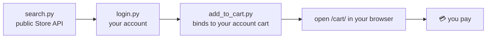

<h1 align="center">🛒 hahishook-shopping</h1>

<p align="center">
  <em>Build your weekly <a href="https://hahishook.com">החישוק</a> grocery cart from the command line — or from a Claude Code agent.</em>
</p>

<p align="center">
  
  
  
  
</p>

A small, dependency-free toolkit (and a [Claude Code](https://docs.claude.com/en/docs/claude-code) skill) for **hahishook.com** — an Israeli nonprofit grocery store running on WooCommerce. It searches the storefront's public **Store API**, logs in with *your own* account, and assembles a cart you then pay for in your browser. **No payment is ever automated.**

> [!WARNING]
> **Unofficial & unaffiliated.** This project is not endorsed by or connected to החישוק. It uses the store's public WooCommerce Store API together with your own login. Please use it gently — החישוק is a nonprofit running on a modest server. Cache results, throttle your requests, and prefer the official daily price feed for bulk data.

## Why

A grocery run is a weekly chore of searching the same staples over and over. This lets an agent (or a cron job) assemble the week's cart for you, and hands you a single link to review and pay — while every sensitive step (login, payment) stays yours.

## How it works



The key idea: items are added to **your account's** cart. WooCommerce persists a logged-in cart server-side, so when you open `hahishook.com/cart/` in your own browser you see exactly what the agent assembled — the "link" is just `/cart/`, and **you** complete the payment. The request details live in [`scripts/`](scripts/).

## Requirements

- **Python 3.8+** — standard library only.
- **`certifi`** *(optional)* — only needed on the python.org macOS build, whose Python doesn't verify TLS against the system root store. Everywhere else (Linux, EC2) the system certificates work and nothing extra is required.

## Usage

**Search** (no login needed):

```bash
python3 scripts/search.py "קפה שחור"
# 259946   ₪5.40   קפה שחור קלוי טחון
```

**Log in** (saves an authenticated session to `cookies.txt`):

```bash
python3 scripts/login.py          # prompts for credentials (no echo, no history)
```

For automation, set `HAHISHOOK_USER` / `HAHISHOOK_PASS` in the environment and it runs non-interactively.

**Build a cart** (`<product-id>:<quantity>` pairs):

```bash
python3 scripts/add_to_cart.py 178225:2 259946:1
# added  178225 x2
# added  259946 x1
# cart: 3 items, ₪18.80
# pay here (same account): https://hahishook.com/cart/
```

Open the printed link in your browser (logged into the same account) and check out.

**Read the cart** (review what's in it before paying):

```bash
python3 scripts/read_cart.py
# 178225   x2   ₪14.40   אורז בסמטי
# cart: 6 items, ₪40.00
# pay here (same account): https://hahishook.com/cart/
```

**Remove from the cart** (by product id):

```bash
python3 scripts/remove_item.py 259946
# removed 259946
```

## As a Claude Code skill

Install it into your skills directory, then invoke it from any session:

```bash
ln -s "$PWD" ~/.claude/skills/hahishook-shopping
```

```
/hahishook-shopping search for rice
```

## Security

- **Your authenticated session lives in `~/.hahishook/cookies.txt` — treat it like a password.** State never lives inside the repo/skill directory (override the location with `HAHISHOOK_HOME`).
- Credentials are read from environment variables or an interactive prompt — never hardcoded, never written to disk, never logged.
- On a server, inject credentials from a secret manager into the environment at runtime rather than storing them.

## Roadmap

- [ ] Weekly `list.json` accumulation — build the list across the week, materialize the cart once.
- [ ] Notification when the cart is ready to pay.
- [ ] Scheduled / EC2 runner with credentials from a secret manager.

## License

[MIT](LICENSE) © 2026 Nir Moshe
